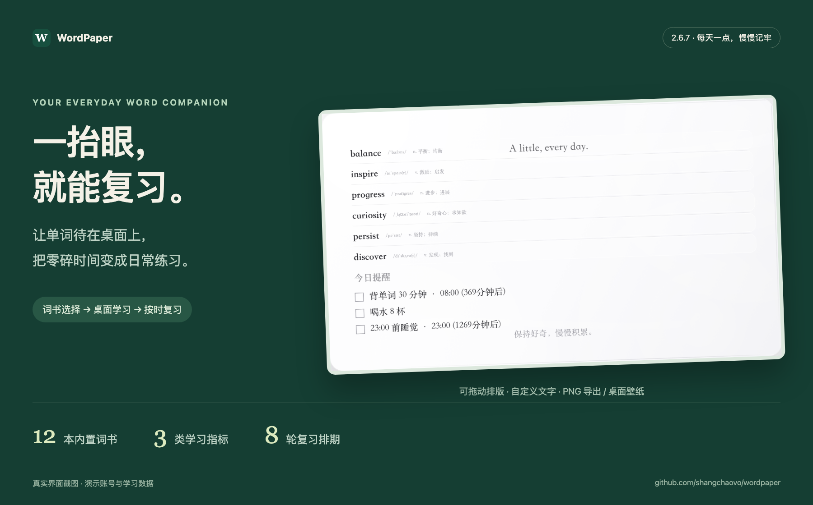
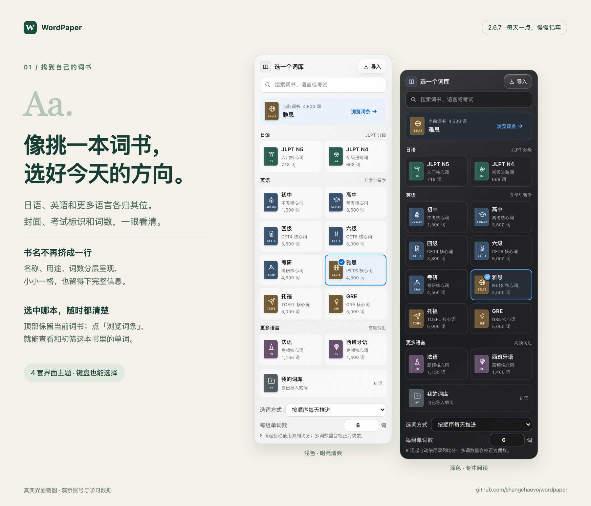
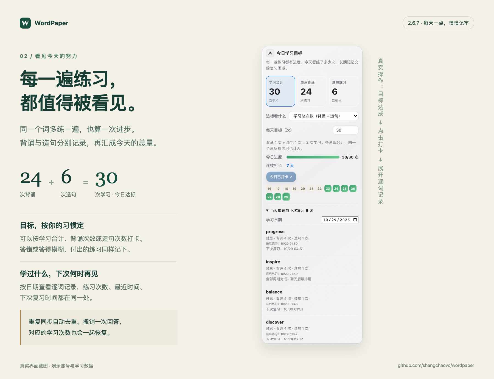
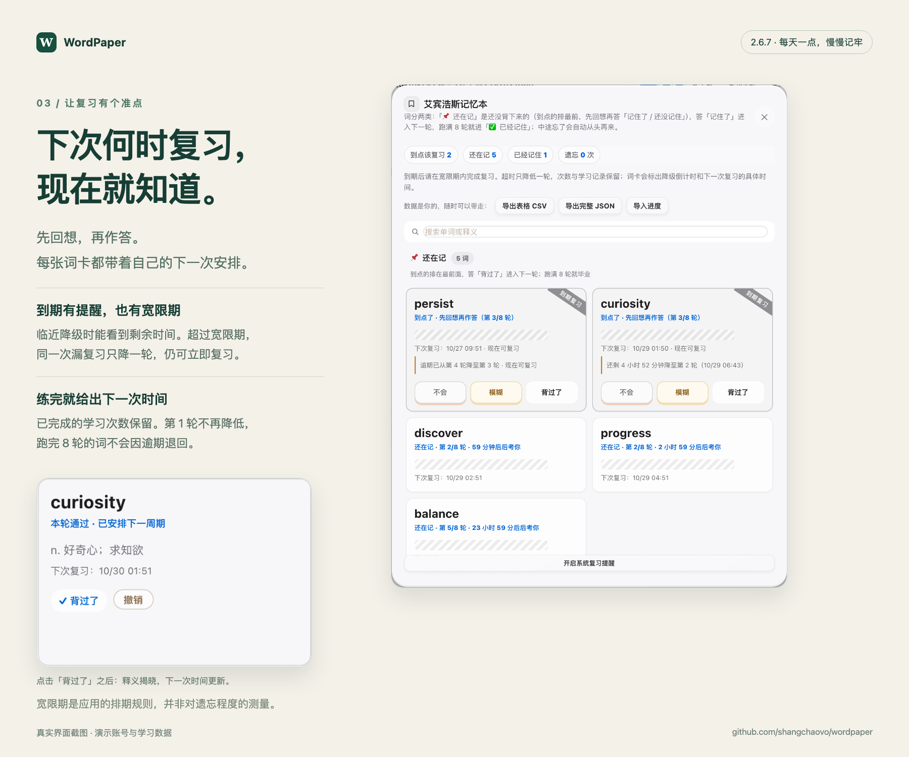
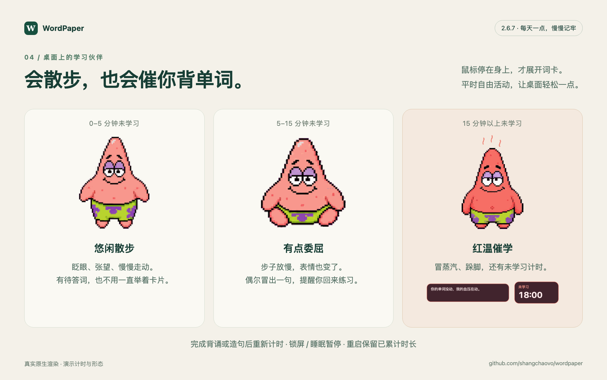

# WordPaper · 把单词做成你的电脑壁纸

背单词老忘，就把当天要看的词做成壁纸。在电脑桌面抬眼就能扫到，不必专门打开背词 App。



**新版 2.6.7：[下载 Mac App](https://github.com/shangchaovo/wordpaper/releases/tag/companion-v2.6.7) · [完整图文介绍与更新说明](docs/releases/v2.6.7.md)**

| 想做什么 | WordPaper 怎么帮你 |
| --- | --- |
| 选一本适合自己的词书 | 12 本内置词书按语言分组，书封对应考试和等级；支持搜索、浏览初筛，也能导入自己的词表。 |
| 把零碎时间用起来 | 单词和提醒放进桌面壁纸，位置可拖动；小词灵支持首轮学习，派大星可以抽查和朗读。 |
| 看清今天练了多少 | 背诵、造句分别计数，同词重复练习也计入；三种目标任选，达标打卡，按日期查看逐词记录。 |
| 不靠记性安排复习 | 每个词显示下次复习时间；到期后有宽限期，超过宽限期只降一轮，已完成的学习次数保留。 |

<details>
<summary><b>展开看新版界面：词书目录、每日学习、复习排期与派大星</b></summary>









派大星有待答词时也会散步，悬停后才展开词卡。持续未学习 5 分钟后进入委屈状态，15 分钟后红温并显示计时器；完成背诵或造句后重新计时，锁屏与睡眠期间暂停。

以上均为真实界面或原生渲染截图，使用独立演示账号、示例学习数据与演示计时。

</details>

已安装 **2.6.2 及以上旧版本** 的用户可在 App 中点「检查更新」。**2.6.1 及更早版本**请下载完整 DMG，覆盖「应用程序」里的 WordPaper.app；账号与学习数据保留在原数据目录。新逐词明细从本版开始积累，旧版没有记录的复习与造句细节不会被补造。逾期规则也适用于已有积压词，详细说明见 [复习规则](docs/REVIEW-POLICY.md)。

如果应用内下载因慢速网络超过 5 分钟而超时，可稍后重试，或从 [正式发布页](https://github.com/shangchaovo/wordpaper/releases/tag/companion-v2.6.7) 下载对应芯片的完整 DMG，退出 App 后替换安装。下载失败不会清空原 App 或学习数据。

**线上：[wordpaper.pages.dev](https://wordpaper.pages.dev/)**  
另有一份 GitHub Pages 镜像：[shangchaovo.github.io/wordpaper](https://shangchaovo.github.io/wordpaper/)

网页打开就能预览电脑壁纸。默认 1920×1080，支持 2K、4K 和自定义尺寸。词库有雅思、四六级、考研、JLPT，也可以自己导入一份。复习按艾宾浩斯排，到点会提醒；导出是 PNG，也可以开 Live 模式当动态壁纸一直转。配色、排版、词数都能改。

Mac 版以独立 WordPaper.app 窗口呈现，可从 Dock 打开、关闭窗口后重新唤出、用 ⌘Q 退出；同时能设置系统壁纸并显示小词灵。网页主体在 Windows / Linux 浏览器里也能用，自动换系统壁纸和 OCR 是 macOS 专属。

派大星显示单词题卡时，轻点它会依次朗读当前单词和英文例句。例句使用真实语音的单词时间点，跟随播放器进度逐词高亮；派大星持续轻摆、起伏和挥手，像素嘴型随真实音量自然开合，停顿、重听或读完时闭嘴。嘴型、动作和文字高亮共用一次播放进度采样；嘴型按各个脸部姿态定位，保留原图脸颊纹理。声音结束后平滑恢复待机。例句气泡保留中文译文，自动避开题卡，读完后淡出；再点一次可从头重听。没有例句时只读单词，空闲时点击仍可打开对话。

点击顶部状态栏 WordPaper 图标，在约 304pt 宽的紧凑菜单内直接选择美式 Aria / Guy、英式 Sonia / Ryan；音色旁的小按钮可试听，试听时才展开逐词跟读文字，结束或收起菜单立即收回。选择自动保存到本机伴侣配置，不再打开独立声音窗口。页面实际放在 `assets/` 下，使已发布的 2.6.2 更新器也能完整复制新入口。发行包自带可搬移的 Python 与 edge-tts 语音环境，无需用户安装开发依赖；源码开发仍可使用 `.venv-tts`。`lib/tts_edge.py` 同时保存音频与 WordBoundary 时间点，缓存按音色、语速和文本区分。离线回退系统声音，缺少时间点时不伪造逐词高亮，也不把系统声音缓存成所选在线音色。系统「减少动态效果」开启时使用静态姿态与直接高亮。`npm run test:speech` 覆盖朗读顺序、连点/换题、音色缓存与持久化、真实原生播放/高亮/动作、浏览器试听及文字排版。

账号存在服务器的 SQLite 里（密码加盐哈希，不存明文）。换电脑登录同一个号，复习进度、自定义词库和布局会跟过来。也可以下载一份 JSON 备份。支持 Google / 微信 / 邮箱登录；第三方入口在服务端配置完成后显示。已有账号可在「账号绑定」里连接 Google、微信或更换绑定。

现在是单入口、多用户，结构大概是这样：

```text
浏览器 ── 同源 HTTPS ──> Node Web + API（一个端口） ──> SQLite 持久卷
                                               └── 每条数据绑定 session user_id

Mac 桌面伴侣（可选）── 127.0.0.1:8771，仅在用户自己的 Mac 上
```

## 桌面 App 与云端账号

桌面窗口使用 macOS Cocoa + WKWebView；本机 Node 服务是 App 内部实现，日常使用不需要开终端、输入 localhost 或把浏览器当主窗口。安装包不包含 Google Client Secret、微信 AppSecret 或 `.env`。

1. 从 DMG 安装并打开 WordPaper.app。没有同步服务器时，可以继续使用原本机账号。
2. 部署账号服务器后，在 App 登录页的「登录同步账号」填入它的 HTTPS 地址，选择 Google、微信或「邮箱 / 原账号登录」。每台设备首次配置一次，之后记住地址。
3. App 打开系统浏览器完成平台授权（避免在嵌入式 WebView 内登录 Google），浏览器显示当前账号与连接码。核对与 App 相同后，点「允许这台 App 同步」。
4. App 自动进入同步工作区；网页和不同电脑的 App 使用同一云端账号。前台每 30 秒及窗口重新获得焦点时拉取变化，正在编辑的输入框、弹窗、拖动和待保存内容会暂缓被远端刷新。离线写入排队，联网后补同步；同时修改同一份数据时仍按现有 revision 冲突规则处理。
5. 绑定或换绑 Google/微信，在 App 的「账号绑定 → 打开账号中心」统一管理。会话失效时从登录页重新授权；无需在设备上保存第三方密码。

桌面授权使用 10 分钟有效的一次性设备码、浏览器明确确认和仅本机服务持有的 SHA-256 verifier；会话令牌通过服务器之间的请求交付，不放进浏览器回跳 URL。每台 App 持有独立云端会话。同步副本按服务器地址和云端账号 ID 区分，不复用同名的本机账号；断开连接不会删除原本机账号。

**交付与上线的区别**：目前仓库列出的 Pages 地址是静态演示站，不能承载账号数据库。需要按下文部署带 SQLite 持久卷的服务并配置平台回调后，真实 Google/微信和跨电脑同步才能启用。微信尚未申请时，其云端入口保持关闭；代码和模拟联调可先完成。

**已有本机账号迁到云端**：先在原入口确认数据已保存并下载账号备份。首次部署一个全新的账号服务器时，按下文「迁移」步骤将原 `wordpaper.sqlite` 迁入服务器的持久卷，再在云端用原账号登录并绑定 Google/微信；之后让各台 App 连接它。不要先在空服务器用 Google 新建另一个账号后期待按同名自动合并。已有云端用户时不要用本机数据库覆盖服务器。

构建：先运行 `python3 scripts/build_speech_runtime.py` 准备两种架构的语音环境，再用 `python3 scripts/package_app.py` 生成三个 DMG；`python3 scripts/test_native_app.py` 使用临时数据验证真实原生窗口、登录桥接及退出后服务清理。首次从旧的“启动浏览器”版本升级到原生窗口，需要安装完整的新 DMG，因为旧更新器不替换主可执行文件。

## 本机启动

需要 Node.js 22.23.2+ 或 Node 24；项目没有第三方 npm 运行依赖。

```bash
npm start
# 打开 http://localhost:8770，创建账号
```

默认数据库在 `~/.wordpaper/wordpaper.sqlite`，不在源码目录里。重启 Node、浏览器或电脑不会清空账号数据。端口被占用时服务会直接报错退出，不会自动换端口，以免 origin 改变后让浏览器缓存看起来像“丢失”。

可以显式指定稳定的数据目录和端口：

```bash
WORDPAPER_DATA_DIR=/absolute/persistent/path PORT=8770 npm start
```

首次创建账号时，当前浏览器旧版的 `wp:*` localStorage 会一次性归入该账号；迁移完成后，本地缓存改用 `wp:user:<user-id>:*`，后续登录的其他账号不会继承这份数据。如果先登录了已有账号，页面只会提示“迁移旧数据”，由用户确认后再导入，避免共享浏览器上的数据被错误认领。

浏览器不允许新域名读取旧域名或 `localhost` 的 localStorage。因此从旧网址迁到新公网域名前，应先在旧入口注册账号并等待同步完成，再按下文迁移数据库/数据卷；可以另外下载账号“备份”留作核对。新域名不能绕过同源策略自动读取旧站数据。

macOS 上若要登录后自动启动，不要复制仓库里的 plist 模板；运行安装脚本，它会自动发现当前电脑的用户名、Node 路径、项目路径和数据目录：

```bash
chmod +x scripts/install_macos_service.sh
./scripts/install_macos_service.sh
```

## 多台 Mac：主账号镜像（卫星模式）

另一台 Mac 上的独立版可以共用主账号，而不是新建一个互不相干的本地账号。模型是**卫星主动拉取**（pull），不是网页直推 localhost：

```text
主力机(本地或公网实例,权威数据)
        ↑ 卫星用账号密码配对一次,持有长期会话
卫星机(另一台 Mac 的独立版)
  读:先补推再拉取,以上游为准覆盖本机缓存
  写:在线直推上游;断网写本机缓存 + 排队,恢复后自动补推
  冲突:上游赢;上游会话过期(约 30 天)转「重新验证」,本机缓存仍可离线用
```

在卫星机的登录页展开「这台是我的另一台电脑？连接到主账号 →」，填主账号所在电脑的地址和账号密码即可。配对后：本地注册/登录入口让位给「继续」；壁纸、小词灵、记忆本全部照常在本机运行。「断开连接」会删除本机同步副本，不影响主账号。

**旧的密码配对仍支持私有网络**；需要跨网络的 Google/微信同步时，使用上述长期在线的 HTTPS 账号服务器：

- **同一 Wi-Fi / 局域网**：`http://主机名.local:8770`（如 `http://mininn.local:8770`）或局域网 IP `http://192.168.x.x:8770`。
- **异地 / 不同网络**：用主力机的 Tailscale 地址 `http://100.x.x.x:8770`（两台都装 Tailscale 后，走加密私有网络，不暴露公网）。
- 公网地址仍可用，但必须 `https://`。

主力机需让 8770 监听所有网卡（默认只听回环，别的电脑连不上）：在 launchd plist 里加 `HOST=0.0.0.0` 并保留 `WORDPAPER_MODE=local`（设了非回环 HOST 后必须显式钉住 local，否则会自动降级成 public、配对被禁用）。

仅 `local` 模式可配对（回环 + Origin 校验 + 限流）；`public` 实例永远是权威数据源，不能做卫星。卫星的后台节拍每 45 秒补推 + 拉取一轮。

## 数据持久化与用户隔离

- 密码使用 Node `crypto.scrypt` 加盐哈希，数据库不保存明文密码。
- 登录使用随机不透明 session token；数据库只保存 token 的 SHA-256。
- Cookie 为 `HttpOnly`，邮箱登录默认 `SameSite=Strict`；发起账号绑定时及 OAuth 回跳 session 使用 `SameSite=Lax`，确保从第三方返回时继续处于原账号；写操作仍要求 Origin 与 CSRF 校验，HTTPS 下都会自动使用 `Secure`。
- `user_state` 的主键是 `(user_id, namespace)`；`user_id` 只从服务端 session 获取，API 不接受客户端指定用户。
- 设置、背景图、自定义词库、初筛、提醒、轮换状态、复习记录和模块布局都保存进 SQLite。
- 每个 namespace 有 revision；两台设备同时覆盖同一份数据时返回冲突，而不是静默丢掉其中一份。
- localStorage 只是按账号分区的本地缓存；服务器数据库才是跨电脑恢复的权威数据源。
- 登录后可点顶栏“备份”，或访问 `/api/export` 下载当前账号的 JSON 备份。

## 登录方式：Google、微信与邮箱

登录页提供邮箱入口，并按服务端配置显示第三方入口：

- **邮箱 + 密码**：注册时先输入 6 位邮件验证码；旧版用户名账号仍可在登录框中继续使用。
- **Google**：服务端 Authorization Code + PKCE，范围仅为 `openid email profile`。
- **微信**：微信开放平台“网站应用”扫码登录，范围为 `snsapi_login`。

Google 和微信首次从登录页授权时会创建独立 WordPaper 账号，之后以 Google `sub` 或“微信 AppID + openid”定位同一账号。服务器不会保存第三方 access token / refresh token，也不会根据昵称或相同邮箱自动合并账号。

**已有账号的正确使用顺序**：先用原邮箱/用户名和密码登录，在页面顶部点「账号绑定」，再分别点「绑定 Google」「绑定 微信」完成授权。绑定写在原账号下，原密码仍可登录，词库、提醒、布局和复习记录保持不变。以后可用任一绑定方式进入同一账号。每个账号最多绑定一个 Google 和一个微信。

**更换和解除绑定**：在「账号绑定」选择「更换绑定」，Google 选择新账号，微信使用新账号扫码确认。只有新授权成功且身份未被占用时才替换旧绑定；取消、失败或冲突时旧绑定不变。解除绑定必须保留原密码或另一种已配置且已绑定的登录方式。更换/解除绑定会注销其他设备的现有会话；当前设备继续使用。如果登录或最近验证已超过 10 分钟，需要先输入原密码，或使用当前绑定的第三方账号重新验证。

若提示身份已被其他账号占用，请先登录那个账号、保留另一种可用登录方式并解绑，再回到要保留数据的账号绑定。**这不是账号数据合并功能**，不会搬走或覆盖另一个账号的记录。卫星镜像模式需要到主账号所在的网站管理绑定。

在 `.env` 中填写对应平台参数并重启服务后，登录页会自动显示已配置的按钮；未配置的入口隐藏，账号绑定页显示「暂未开放」。完整变量见 [`.env.example`](.env.example)。已有 `.env` 时只补字段，不要用模板覆盖已有密钥。纯静态演示站不具备第三方登录，正式登录须部署 `server.js` 和持久化 SQLite。

Google Cloud 需要创建 Web application 类型 OAuth 客户端，并登记完全一致的回调：

```text
https://你的域名/api/auth/google/callback
```

参见 [Google OpenID Connect](https://developers.google.com/identity/openid-connect/openid-connect) 与 [Web Server OAuth 指南](https://developers.google.com/identity/protocols/oauth2/web-server)。

Google 配置使用 `WORDPAPER_GOOGLE_CLIENT_ID`、`WORDPAPER_GOOGLE_CLIENT_SECRET`、`WORDPAPER_GOOGLE_REDIRECT_URI`。开发环境可单独登记 `http://localhost:8770/api/auth/google/callback`，并从 `http://localhost:8770` 访问；`localhost`、`127.0.0.1` 和公网域名不能混用。测试模式下，将需要参与测试的账号加入 Google Auth Platform 的测试用户列表。正式发布前按控制台要求完成品牌、受众及发布设置。

微信需要先在微信开放平台创建并审核“网站应用”，再申请“微信登录”能力；授权域名必须与公网回调域名一致：

```text
https://你的域名/api/auth/wechat/callback
```

参见 [微信网站应用登录指南](https://developers.weixin.qq.com/doc/oplatform/Website_App/WeChat_Login/Wechat_Login.html)。AppSecret 只放服务器环境变量，禁止提交 Git 或发送给浏览器。

**尚未申请微信网站应用时**：

1. 在 [微信开放平台](https://open.weixin.qq.com/) 注册账号，按平台当前要求完成开发者资质认证。主体资格、材料、费用及审核要求以控制台为准。
2. 在「管理中心 → 网站应用」创建 WordPaper，提交网站地址、应用信息及平台要求的材料；等待网站应用审核和微信登录能力开通。这套接入使用网站应用的 `snsapi_login`，不能直接填写公众号或小程序的 AppID。
3. 配置网站应用的授权回调域，确保它与实际访问的 HTTPS 网站域名一致。完整回调 URL 在 WordPaper 环境变量里填写；微信控制台域名字段按该字段说明填写域名。
4. 取得 AppID / AppSecret 后，只在部署服务器的 `.env` 补充以下字段，不要写进前端、Git 或桌面安装包：

```dotenv
WORDPAPER_WECHAT_APP_ID=你的微信网站应用AppID
WORDPAPER_WECHAT_APP_SECRET=你的微信网站应用AppSecret
WORDPAPER_WECHAT_REDIRECT_URI=https://你的域名/api/auth/wechat/callback
```

5. 确认 `WORDPAPER_PUBLIC_ORIGIN=https://你的域名`；经受控反代提供 HTTPS 时按下文配置 `TRUST_PROXY=1`。重启部署服务（Compose 使用 `docker compose up -d --build`），从该域名进入原账号的「账号绑定」扫码授权，再退出并使用微信登录，核对原有记录。

微信回调必须回到发起操作的同一云端站点，才能验证浏览器 Cookie。桌面 App 通过设备授权连接该站点，不把第三方回调指向每台电脑的 localhost。独立版不内置 AppSecret，登录绑定在主站统一管理。

验证命令：`node scripts/test_account_links.js` 覆盖绑定安全与数据保留；`node scripts/test_desktop_sync.js` 覆盖两台 App + 云端同步、一次性授权和本机账号隔离；`npm run test:account-browser` 与 `npm run test:desktop-browser` 验证实际页面操作及浏览器授权返回。全部使用临时数据库和模拟平台，不代替开通后使用真实账号的联调。

邮箱验证码使用 [Resend Send Email API](https://resend.com/docs/api-reference/emails/send-email)。先在 Resend 验证发信域名，再在 `.env` 填写：

```dotenv
WORDPAPER_RESEND_API_KEY=re_xxxxxxxxx
WORDPAPER_EMAIL_FROM=WordPaper <login@你的域名>
```

验证码 10 分钟内有效、最多尝试 5 次，同一邮箱 60 秒内不能重复发送。正式公网环境未配置邮件服务时，登录仍可用，但邮箱自助注册会明确禁用；本机 loopback 开发模式会把测试验证码直接填入页面，不会假装已经发出邮件。

## 公网部署（单端口）

复制环境模板并启动：

```bash
cp .env.example .env
# 编辑 .env，填写正式 HTTPS 域名
docker compose up -d --build
```

Compose 只映射一个 Web 端口，且只挂载一个持久卷：

- 公网 / 反向代理入口：`${WORDPAPER_PORT:-8770}`
- 容器应用端口：`8770`
- 持久数据卷：`wordpaper-data` → `/data`
- 不映射、也不启动 `8771`

镜像构建阶段会预生成完整的 Mac 伴侣 zip（包含 Web/API、登录页、公共词库和启动器）；运行中的公网容器只读取并下载它，不会为每次下载启动 Python。

正式环境应由 Nginx、Caddy 或云平台终止 HTTPS，并配置：

```dotenv
WORDPAPER_PUBLIC_ORIGIN=https://wordpaper.example.com
TRUST_PROXY=1
```

`TRUST_PROXY=1` 表示只信任一跳受控反向代理：代理必须覆盖或追加 `X-Forwarded-For / Proto / Host`，应用端口必须像 Compose 默认值一样只绑定 `127.0.0.1`，防火墙也不能允许公网绕过代理直连 8770。服务取右侧最后一跳客户端地址，客户端伪造在左侧的 X-Forwarded-For 不会绕过登录与验证码限流。

不要把 SQLite 放在临时 / serverless 文件系统，也不要让多个应用副本同时共享这一个 SQLite 文件。需要水平扩容时，应先把 `lib/storage.js` 的存储适配迁移到 PostgreSQL。

### 迁移到另一台服务器

先停止写入，再备份整个数据卷：

```bash
docker compose stop
docker run --rm \
  -v wordpaper-data:/data \
  -v "$PWD":/backup \
  alpine sh -c 'tar czf /backup/wordpaper-data.tar.gz -C /data .'
docker compose start
```

把源码、`.env` 和 `wordpaper-data.tar.gz` 复制到新电脑后：

```bash
docker volume create wordpaper-data
docker run --rm \
  -v wordpaper-data:/data \
  -v "$PWD":/backup \
  alpine sh -c 'tar xzf /backup/wordpaper-data.tar.gz -C /data'
docker compose up -d --build
```

数据库、账号、session 和所有用户状态会一起迁移。恢复前不要在目标卷里放另一套数据。

首次从本机 App 迁到一个**尚无用户数据的新服务器**时，先退出 WordPaper 和伴侣，再用 SQLite 备份 API 导出一致的数据库（不要只复制正在使用的 `.sqlite` 而遗漏 WAL）。默认 App 路径是 `~/.wordpaper/wordpaper.sqlite`；自定义过 `WORDPAPER_DATA_DIR` 时改用实际路径：

```bash
python3 - <<'PY'
import sqlite3
from pathlib import Path
source = Path.home() / '.wordpaper/wordpaper.sqlite'
target = Path.cwd() / 'wordpaper-migration.sqlite'
if not source.is_file() or target.exists():
    raise SystemExit('请核对源数据库路径，并使用一个尚不存在的导出文件名')
with sqlite3.connect(source.as_uri() + '?mode=ro', uri=True) as src:
    with sqlite3.connect(target) as dst:
        src.backup(dst)
PY
```

将导出文件私下传到新服务器的项目目录，完成服务器 `.env` 后执行：

```bash
docker compose stop
docker volume create wordpaper-data
docker run --rm -v wordpaper-data:/data -v "$PWD":/backup:ro alpine \
  sh -c 'test ! -e /data/wordpaper.sqlite && cp /backup/wordpaper-migration.sqlite /data/wordpaper.sqlite && chmod 600 /data/wordpaper.sqlite'
docker compose up -d --build
```

若复制命令因目标数据库已存在而失败，先核对目标，不能直接覆盖。迁移后在云端用原账号核对词库、提醒和进度，再绑定第三方账号。已是同步副本的 App 不应作为迁移源，应备份它连接的主账号服务器。

## 两个端口与桌面伴侣

- `8770` 是网页和 API 的唯一应用入口。
- `8771` 仅属于可选的 Mac 桌面伴侣，而且固定绑定 `127.0.0.1`。
- `public` 模式不会在云主机上 probe、spawn 或代理服务器自己的桌面伴侣；相关控制端点返回 404。
- `local` 模式可使用伴侣，但首次使用它的账号会成为这台本地伴侣的 owner，其他 Web 账号不能读取或操控它。
- 公网用户若要自动设置 Mac 壁纸，需要把伴侣安装在自己的 Mac 上。网页主体仍可在 macOS、Windows 和 Linux 的浏览器使用；Apple Vision OCR、`osascript` 壁纸和小词灵窗口是 macOS 专属。

伴侣配置、学习状态、自定义词和窗口位置默认放在 `~/Library/Application Support/WordPaper/companion/`，不再写进源码/解压目录。第一次启动新版伴侣时会把旧目录里的同名文件复制过去，旧文件保留用于回退。可用 `WORDPAPER_COMPANION_DATA_DIR` 改到其他持久目录。

## 静态资源安全边界

服务只公开：

- `/index.html`、`/login.html`
- `/css/**`
- `/js/**`
- `/data/*.json`（公共内置词库）

数据库、源码、`.git`、伴侣配置和用户文件都不在静态白名单中；解码后的路径还会再次做目录 containment 校验。

## 测试

```bash
npm test

# 对一个已经启动的临时测试服务跑真实浏览器账号流程：
WORDPAPER_TEST_BASE_URL=http://127.0.0.1:18991 npm run test:browser
```

服务端测试覆盖：账号 A/B 隔离、session/密码哈希、revision 冲突、停止后重启恢复、敏感文件拒绝、目录穿越拒绝，以及 public 模式禁用桌面伴侣。浏览器测试覆盖：旧 localStorage 安全自动迁移与显式迁移、刷新恢复、退出/切换账号和同一浏览器内 A/B 不串数据。

## Liquid Glass 主题

Liquid 主题把中央展示板、顶栏操作组、预览工具、桌面伴侣入口和弹窗都作为不同厚度的动态玻璃；左右设置区使用更稳定的磨砂材质，避免层层玻璃抢夺内容。进入主题时会联动到壁纸配色里的「玻璃」并使用纯净背景；该配色不自动叠加星点装饰，仍可手动选择其他背景纹理。未选中的配色色块会适度降饱和，避免跳出主题。默认材质是中性珍珠白与冰蓝灰；强调色只用于主操作与焦点状态。

实现依据 Apple 的 [HIG Materials](https://developer.apple.com/design/human-interface-guidelines/materials)、[Meet Liquid Glass](https://developer.apple.com/videos/play/wwdc2025/219/) 和 [Get to know the new design system](https://developer.apple.com/videos/play/wwdc2025/356/)。Web 端的圆角矩形边缘位移、折射缓存、RGB 微色散和降级策略参考了 MIT 许可的 [shuding/liquid-glass](https://github.com/shuding/liquid-glass)、[rdev/liquid-glass-react](https://github.com/rdev/liquid-glass-react) 与 [LiquidGlass-UI](https://github.com/hwyuanzi/LiquidGlass-UI) 的公开思路，项目中采用无运行依赖的原生实现。

玻璃不是单一透明色：运行时会为每块主要表面生成边缘位移贴图，并组合背景模糊、细微 RGB 色散、内外高光和随指针移动的焦散；展示板与弹窗使用更深的位移，按钮按压时会产生短促的液态收缩。壁纸自身也使用多层环境光、宽幅焦散和一块半透明内容玻璃，保证导出结果与界面材质属于同一套语言。

`prefers-reduced-motion` 会关闭环境漂移、弹性与跟随光；`prefers-reduced-transparency` 会让展示板等表面改用高不透明材质；高对比度和强制色模式也有独立回退。

## 词库与渲染脚本

```bash
python3 scripts/build_wordlibs.py
python3 scripts/render_v3.py
```

内置词库来自免费的 [ECDICT](https://github.com/skywind3000/ECDICT) 与开放 JLPT 词表，生成后的公共 JSON 位于 `data/`。
