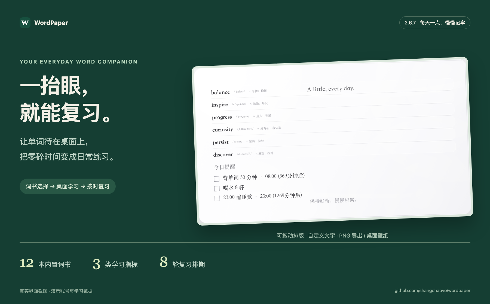

# WordPaper · 单词壁纸

备考英语或日语时，可以把当天要学和要复习的词排成一张壁纸，在网页预览、下载 PNG，或用 Mac 桌面伴侣设为系统背景。

**做第一张壁纸。** 打开[网页演示](https://wordpaper.pages.dev/)，选一本词书（如「四级」），在「壁纸预览」点「换一组」，拖动单词块到合适的位置，再点「下载」。需要另一种分辨率，可在导出前从默认的 1920×1080 改为 2K、4K 或自定义尺寸。[网页镜像](https://shangchaovo.github.io/wordpaper/)



## 选择学习方式

| 想做什么 | 入口与结果 |
| --- | --- |
| 偶尔做张壁纸 | 静态网页可在 macOS、Windows、Linux 的浏览器中用。12 本内置词书覆盖英语、日语、法语和西班牙语，也可导入自己的词表，调整词数、提醒、背景和排版。「实时」会在网页全屏轮换。 |
| 在 Mac 桌面边用边学 | 安装与芯片匹配的 App，打开后可自动换系统壁纸、用 Apple Vision 做 OCR，或让桌面小词灵抽查、朗读单词与例句。[下载 Mac App](https://github.com/shangchaovo/wordpaper/releases/latest) |
| 在两台 Mac 继续同一份进度 | 在两台 App 登录同一云账号，在系统浏览器核对连接码并确认。词库、提醒、布局和复习进度随账号同步，离线改动恢复连接后补传。[云端账号入口](https://wordpaper-api.onrender.com/) |

在预览中选词加入「记忆本」，即可查看逐词的下一次复习时间。每日目标分别统计背诵与造句，同一词反复练也计次。词条按八轮间隔安排复习，过了本轮宽限期只退一轮，已完成的学习次数保留。旧版未记录的逐词明细不会补算。[复习规则](docs/REVIEW-POLICY.md) · [词书目录](docs/screenshots/v2.6.7/02-library.png) · [每日记录](docs/screenshots/v2.6.7/03-daily-learning.png) · [复习界面](docs/screenshots/v2.6.7/04-review.png)

### 桌面小词灵怎么用

派大星显示词卡时，轻点可听单词和英文例句。带语音时间点的例句可逐词高亮，中文译文留在卡片上。先点派大星或词卡启用键盘操作，悬停不抢焦点。[词卡截图](docs/screenshots/v2.6.7/05-patrick.png)

- **背词时**用 `A/S/D/F` 选答案，空格重听，`←/→` 换例句。`Enter` 跳过未作答的词，不计为学会；`Delete` 标记「已熟悉」，会取消该词后续排期，保留已有历史。
- **走动时**用方向键移动，空格暂停，`C` 打开聊天，`?` 查完整帮助，`K` 改键。也可到主窗口「桌面小词灵 → 快捷键设置」调整。
- **需要 AI 例句或造句时**，在「设置 → 模型接口」绑定自己的 OpenAI Chat Completions 兼容接口（如 DeepSeek）或 Anthropic Messages 接口。「验证并绑定」会实际调用服务商，成功才保存。词条、造句和相关对话会发给所选服务商，费用计入该接口账号。生成的例句按账号缓存在本机，可离线复用。[账号模型接入](docs/MODEL-API.md)
- **想换声音时**，在「设置 → 语音设置」试听内置配置的微软音色，或绑定兼容 `/audio/speech` 的接口。接口合成失败时会停止朗读。

## 游客、账号与旧版升级

- **只在一台设备试用**，可在登录页选「以游客身份继续」。网页游客保存在当前站点的 IndexedDB，清除站点数据或结束无痕会话会丢失。Mac 游客资料保存在 App 数据目录的 `guest/`。游客和登录账号各自保存，游客记录不上传云端。
- **已有学习记录**，请用原方式登录，再到「账号绑定」添加 Google 或 GitHub。用尚未绑定的第三方身份直接登录，会新建独立账号。顶栏「备份」可导出当前账号数据；模型密钥及本机生成的例句缓存不随普通备份导出。
- **从旧 Mac App 升级**，2.6.2 及以后版可点「检查更新」；2.6.1 及更早版、首次从旧浏览器启动器换原生窗口，或更新下载超时，请退出 App 并用完整 DMG 替换。学习数据保留在原数据目录。[发布页](https://github.com/shangchaovo/wordpaper/releases/latest) · [更新日志](CHANGELOG.md)
- **从旧的电脑间同步转到云账号**，2.6.12 起会暂停旧配对。确认「断开旧连接」后才清除配对，并先在 `recovery/` 留下恢复副本。旧服务器与云账号已有的学习历史不会自动合并。同步中遇到无法自动合并的编辑，可在「冲突副本」中下载 JSON 或恢复选定版本。[云端数据迁移与恢复](docs/POSTGRES-MIGRATION.md)

## 从源码在本机启动

支持 Node.js 22.23.2 及以上的 22.x 版本，也支持 24.x。在仓库根目录启动网页和账号服务。

```bash
npm start
```

打开 `http://localhost:8770` 创建账号。默认 SQLite 数据库在 `~/.wordpaper/wordpaper.sqlite`。如需指定持久目录或端口，可用 `WORDPAPER_DATA_DIR=/absolute/persistent/path PORT=8770 npm start`。端口占用时服务直接退出。可选的 Mac 桌面伴侣仅监听本机 `127.0.0.1:8771`。

旧浏览器的 `wp:*` 数据只能从原站点读取。首次创建账号可迁入旧记录，登录已有账号需要确认。迁域名前先从旧入口登录并完成同步，再备份原服务器。macOS 登录自启请用 [安装脚本](scripts/install_macos_service.sh)，它会按本机路径生成配置。

### 自托管账号服务

1. 从 `.env.example` 复制 `.env`，设置 HTTPS 地址 `WORDPAPER_PUBLIC_ORIGIN`。在受控 HTTPS 反向代理后运行 `docker compose up -d --build`。Compose 将应用端口绑定在回环地址，SQLite 使用 `wordpaper-data` 持久卷。启用 `TRUST_PROXY=1` 时，只允许受控代理转发到该端口。
2. 按需启用 Google、GitHub 或邮箱注册。在提供方登记与该实例一致的 `/api/auth/google/callback` 或 `/api/auth/github/callback`，并按模板设置对应的客户端 ID 和密钥。邮箱自助注册需要 Resend 发信密钥及已验证的发信域名，可从 `/api/auth/providers` 核对启用项。[环境模板](.env.example)
3. 若使用 Supabase PostgreSQL，设置 `WORDPAPER_STORAGE_BACKEND=postgres`、数据库连接串和加密主密钥，按顺序执行迁移；私有背景图另需初始化 Storage。`/healthz` 可检查数据库。换服务器前先停止写入，备份整个数据卷或用 SQLite backup API 创建含 WAL 已提交数据的一致快照，同时保管模型主密钥。先在空目标验证恢复，再切换原账号。[Render 模板](render.yaml) · [数据库迁移](supabase/migrations/) · [背景图 Storage](supabase/storage/wordpaper_backgrounds.sql) · [迁移与恢复指南](docs/POSTGRES-MIGRATION.md)

Mac 本机账号可单独绑定 Google。把自己的 Google「桌面应用」OAuth 客户端配置放在应用数据目录的 `google-desktop.json`（默认目录 `~/.wordpaper/`），用 `chmod 600` 限制读取。先用原本机账号登录并绑定身份，再用 Google 登录。此流程只影响该 Mac 的本机账号。

项目测试入口为 `npm test`。真实浏览器流程见 `npm run test:browser`（需用 `WORDPAPER_TEST_BASE_URL` 指向已启动的临时测试服务），macOS 原生流程见 `npm run test:mac`。自行打包 Mac 版先运行 `python3 scripts/build_speech_runtime.py`，再运行 `python3 scripts/package_app.py`。[贡献说明](CONTRIBUTING.md)

## 许可与来源

项目代码采用 [MIT 许可证](LICENSE)。英语词书来自 [ECDICT](https://github.com/skywind3000/ECDICT)，日语 JLPT 采用开放词表，法语和西班牙语词频与释义的来源及许可见[词书署名](data/ATTRIBUTION.md)。

Liquid Glass 主题采用原生实现，参考了 Apple 的 [HIG Materials](https://developer.apple.com/design/human-interface-guidelines/materials)、[Meet Liquid Glass](https://developer.apple.com/videos/play/wwdc2025/219/) 和 [Get to know the new design system](https://developer.apple.com/videos/play/wwdc2025/356/)，以及 MIT 许可项目 [shuding/liquid-glass](https://github.com/shuding/liquid-glass)、[rdev/liquid-glass-react](https://github.com/rdev/liquid-glass-react) 和 [LiquidGlass-UI](https://github.com/hwyuanzi/LiquidGlass-UI)。
