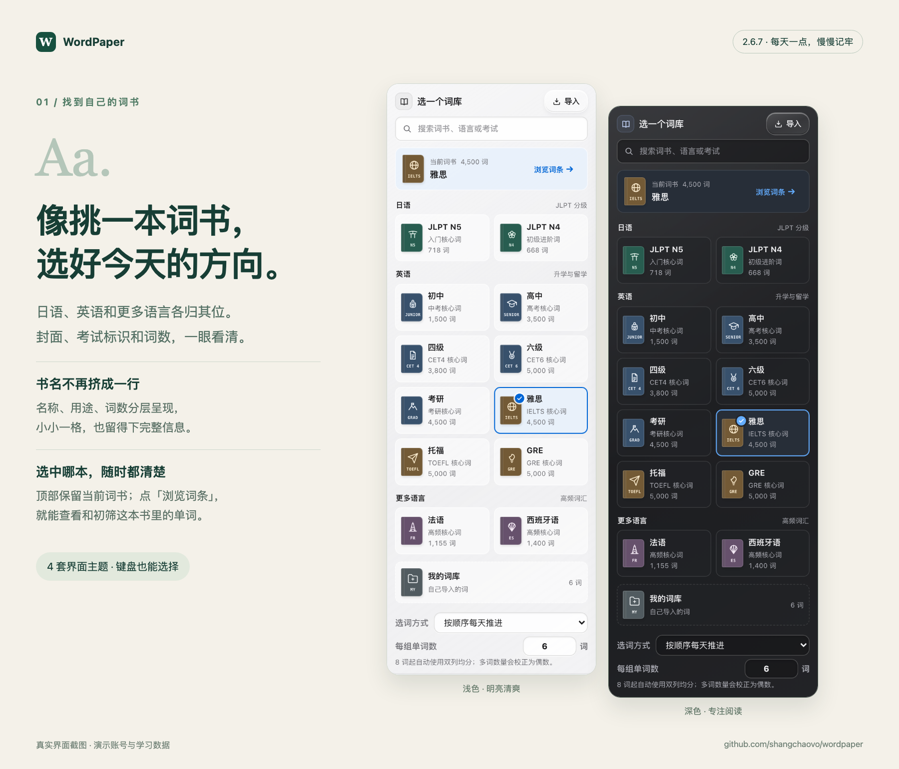
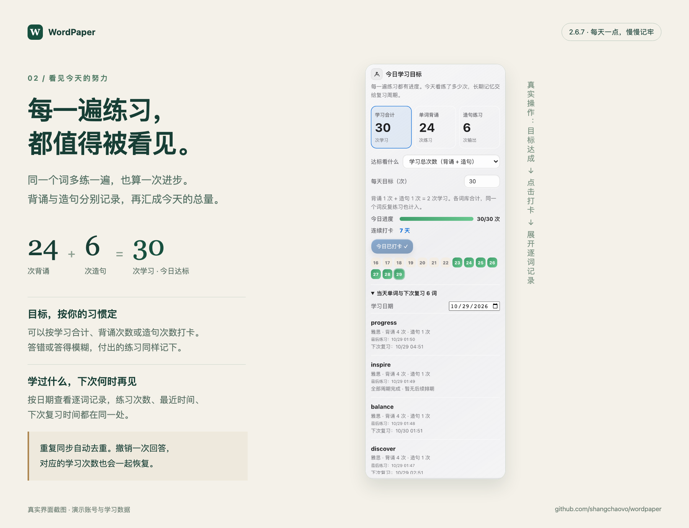
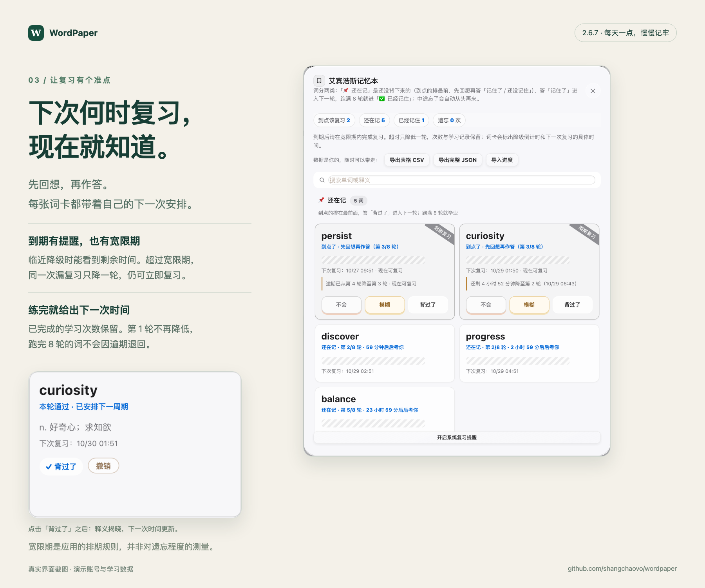
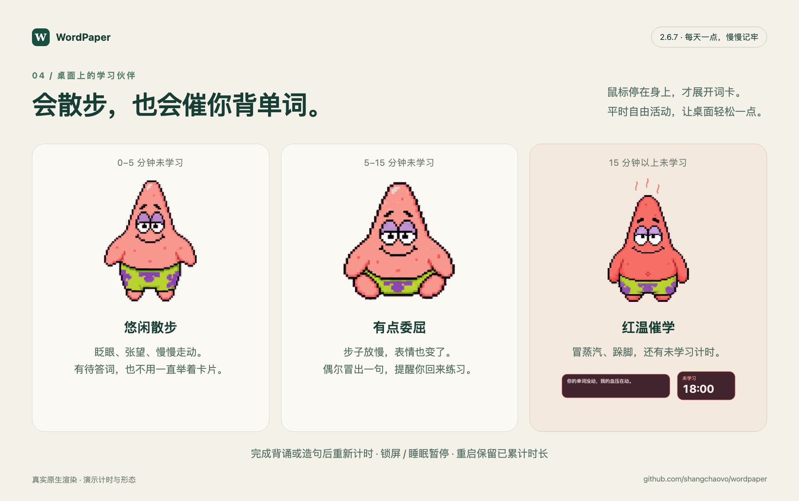

# WordPaper · 把单词做成你的电脑壁纸

背单词老忘，就把当天要看的词做成壁纸。在电脑桌面抬眼就能扫到，不必专门打开背词 App。

**账号模型接口（开发版）**：主窗口右上角的「设置 → 模型接口」或造句窗的同名按钮可配置 Base URL、模型名称与 API Key。支持 OpenAI Chat Completions 兼容接口（例如 DeepSeek）与 Anthropic Messages；点击「验证并绑定」会实际调用模型，成功后才保存，失败保留原配置。具体接口与安全、备份说明见 [账号模型接入](docs/MODEL-API.md)。


**新版 2.6.7：[下载 Mac App](https://github.com/shangchaovo/wordpaper/releases/tag/companion-v2.6.7) · [完整图文介绍与更新说明](docs/releases/v2.6.7.md)**

| 想做什么 | WordPaper 怎么帮你 |
| --- | --- |
| 选一本适合自己的词书 | 12 本内置词书按语言分组，书封对应考试和等级；支持搜索、浏览初筛，也能导入自己的词表。 |
| 把零碎时间用起来 | 单词和提醒放进桌面壁纸，位置可拖动；小词灵支持首轮学习，派大星可以抽查和朗读。 |
| 看清今天练了多少 | 背诵、造句分别计数，同词重复练习也计入；三种目标任选，达标打卡，按日期查看逐词记录。 |
| 不靠记性安排复习 | 每个词显示下次复习时间；到期后有宽限期，超过宽限期只降一轮，已完成的学习次数保留。 |

<details>
<summary><b>展开看新版界面：词书目录、每日学习、复习排期与派大星</b></summary>









派大星有待答词时也会散步，悬停后才展开词卡。持续未学习 5 分钟后进入委屈状态，15 分钟后红温并显示计时器；完成背诵或造句后重新计时，锁屏与睡眠期间暂停。

以上均为真实界面或原生渲染截图，使用独立演示账号、示例学习数据与演示计时。

</details>

已安装 **2.6.2 及以上旧版本** 的用户可在 App 中点「检查更新」。**2.6.1 及更早版本**请下载完整 DMG，覆盖「应用程序」里的 WordPaper.app；账号与学习数据保留在原数据目录。新逐词明细从本版开始积累，旧版没有记录的复习与造句细节不会被补造。逾期规则也适用于已有积压词，详细说明见 [复习规则](docs/REVIEW-POLICY.md)。

如果应用内下载因慢速网络超过 5 分钟而超时，可稍后重试，或从 [正式发布页](https://github.com/shangchaovo/wordpaper/releases/tag/companion-v2.6.7) 下载对应芯片的完整 DMG，退出 App 后替换安装。下载失败不会清空原 App 或学习数据。

**线上：[wordpaper.pages.dev](https://wordpaper.pages.dev/)**  
另有一份 GitHub Pages 镜像：[shangchaovo.github.io/wordpaper](https://shangchaovo.github.io/wordpaper/)

网页打开就能预览电脑壁纸。默认 1920×1080，支持 2K、4K 和自定义尺寸。词库有雅思、四六级、考研、JLPT，也可以自己导入一份。复习按艾宾浩斯排，到点会提醒；导出是 PNG，也可以开 Live 模式当动态壁纸一直转。配色、排版、词数都能改。

Mac 版以独立 WordPaper.app 窗口呈现，可从 Dock 打开、关闭窗口后重新唤出、用 ⌘Q 退出；同时能设置系统壁纸并显示小词灵。网页主体在 Windows / Linux 浏览器里也能用，自动换系统壁纸和 OCR 是 macOS 专属。

派大星显示单词题卡时，轻点它会依次朗读当前单词和英文例句。例句使用真实语音的单词时间点，跟随播放器进度逐词高亮；派大星持续轻摆、起伏和挥手，像素嘴型随真实音量自然开合，停顿、重听或读完时闭嘴。嘴型、动作和文字高亮共用一次播放进度采样；嘴型按各个脸部姿态定位，保留原图脸颊纹理。声音结束后平滑恢复待机。例句气泡保留中文译文，自动避开题卡，读完后淡出；再点一次可从头重听。英语单词缺少例句时，会调用当前账号绑定的模型（支持 Magpie 的 DeepSeek 兼容接口）即时补充英文例句与中文译文；先读单词，例句上屏后再朗读英文。生成结果按账号、词库及词条存入本机数据库，之后离线、重启或升级都能复用。已有例句优先，失败可稍后重试，不影响单词发音。空闲时单击选中派大星，按 C 打开对话。

**派大星键盘操作**：先单击派大星或词卡启用；悬停和自动出题不抢键盘焦点。切到其他应用、聊天或造句输入框后，按键由输入窗口处理。

| 场景 | 快捷键 | 操作 |
| --- | --- | --- |
| 背单词 | Delete / ⌫（也支持向前删除） | 直接标记“已熟悉”：取消该词后续复习，保留已有学习次数与历史，不计为答对本轮。 |
| 背单词 | Enter / 数字键盘回车 | 下一词；未作答时跳过，不记录为学会。优先选择其他到期词。 |
| 背单词 | ← / → | 上一条 / 下一条例句；末尾进入“AI 生成新例句”，点击按钮或再按右方向键生成并追加保存；没有例句时自动生成。 |
| 背单词 | A / S / D / F | 分别选择选项 A / B / C / D，等同点击。选项右侧显示当前快捷键。长选项会先展开，再次按键才提交。 |
| 背单词 | 空格 / E / G / ↑ ↓ | 重听当前词与例句 / 展开或收起释义 / 答题后造句 / 滚动长卡片。 |
| 自由走动 | ↑ ↓ ← → | 按住向对应方向走，支持斜向移动；松开立即停止。Shift 加速。 |
| 自由走动 | 空格 / Enter | 暂停或恢复自动散步 / 显示待答题或开始背词。 |
| 两种场景 | Esc / C / ? / K | 收起卡片回到走动 / 打开聊天 / 显示或收起快捷键帮助 / 打开快捷键设置。 |

快捷键不会重置闲置学习计时，只有实际学习记录才会重置。Delete、Enter 和答案键每次按下只处理一次，长按不会连续标熟或跳题。`npm run test:shortcuts` 验证 SRS 写入、旧题拒绝、例句切换、真实 AppKit 键盘事件、移动边界和输入框隔离。

主窗口「桌面小词灵 → 快捷键设置」可修改以上按键，也支持 Shift / Control / Option / Command 组合键。点击一个按键后录入新键；同场景冲突会提示并禁止保存，背词和走动允许复用按键。可一键恢复默认。设置保存在本机伴侣配置，重启后保留；保存后原生窗口、选项按键标记和帮助同步更新。全局系统常用键（如 ⌘Q、⌘W）保留给系统。

在本机工作台右上角的「设置 → 语音设置」可为当前账号绑定 OpenAI，或填写兼容 `/audio/speech` 的基础地址、模型、声音和 API Key。密钥按账号加密保存在本机。状态栏支持试听和查看当前声音。未配置接口时，可选微软美式 Aria / Guy 和英式 Sonia / Ryan，发行包自带 edge-tts 运行环境。接口合成失败时停止朗读。

状态栏页面位于 `assets/`，供 2.6.2 起的更新器复制。源码开发可使用 `.venv-tts`。`lib/tts_edge.py` 保存微软语音的 WordBoundary 时间点，按音色、语速和文本缓存；自定义接口的 MP3 按账号、地址、模型、声音和文本缓存。返回时间点的音频支持逐词高亮，启用「减少动态效果」后使用静态姿态。`npm run test:speech` 覆盖账号隔离、自定义接口、朗读顺序、连点换题、原生播放与浏览器试听。

账号和学习数据保存在账号服务器的数据库。自托管默认使用 SQLite，公网服务可连接 Supabase PostgreSQL。换电脑登录同一个账号时，复习进度、自定义词库和布局会随账号同步。WordPaper 提供 Google 和邮箱登录，已有账号可在「账号绑定」里连接 Google。

现在是单入口、多用户，结构大概是这样：

```text
浏览器 ── 同源 HTTPS ──> Node Web + API（一个端口） ──> SQLite 持久卷
                                               └── 每条数据绑定 session user_id

Mac 桌面伴侣（可选）── 127.0.0.1:8771，仅在用户自己的 Mac 上
```

## 桌面 App 与云端账号

桌面窗口使用 macOS Cocoa + WKWebView；本机 Node 服务是 App 内部实现，日常使用不需要开终端、输入 localhost 或把浏览器当主窗口。安装包不包含 Google Client Secret、微信 AppSecret 或 `.env`。

**本机账号使用 Google 登录**。在 Google Auth Platform 创建「桌面应用」OAuth 客户端，把下载的 JSON 放在 App 数据目录 `~/.wordpaper/google-desktop.json`，并限制为当前用户可读（`chmod 600`）。使用自定义 `WORDPAPER_DATA_DIR` 时放在该目录。先在本机 App 登录原账号，从「账号绑定」验证身份并绑定 Google。之后可在登录页选择「使用 Google 登录本机账号」，词库、提醒和复习记录仍归属原本机账号。授权在系统浏览器完成，回调使用临时本机端口，当前入口只用于直接在这台 Mac 使用的账号。

自托管 Mac 也可使用已登记 `http://localhost:8770/api/auth/google/callback` 的 WordPaper Web 客户端，将 `client_id`、`client_secret` 和该 `redirect_uri` 保存到同一目录的 `google-local-web.json`，并设为 `600` 权限。此配置需要 `127.0.0.1:8770` 可单独监听。文件包含 Web 客户端密钥，须保留在用户的数据目录。App 优先使用桌面客户端配置。

**跨电脑同步**需要单独连接账号服务器。

1. 从 DMG 安装并打开 WordPaper.app。没有同步服务器时，可以继续使用原本机账号。
2. 部署账号服务器后，在 App 登录页的「跨设备同步」填入它的 HTTPS 地址，选择 Google 或「邮箱 / 原账号登录」。每台设备首次配置一次，之后记住地址。
3. App 打开系统浏览器完成平台授权（避免在嵌入式 WebView 内登录 Google），浏览器显示当前账号与连接码。核对与 App 相同后，点「允许这台 App 同步」。
4. App 自动进入同步工作区；网页和不同电脑的 App 使用同一云端账号。前台每 30 秒及窗口重新获得焦点时拉取变化，正在编辑的输入框、弹窗、拖动和待保存内容会暂缓被远端刷新。离线写入先落本机 SQLite，恢复连接后按原 revision 补传。顶部显示待同步、需重新验证或冲突状态。
5. 绑定或换绑 Google，在 App 的「账号绑定 → 打开账号中心」统一管理。会话失效时从登录页重新授权。

桌面授权使用 10 分钟有效的一次性设备码、浏览器明确确认和仅本机服务持有的 SHA-256 verifier；会话令牌通过服务器之间的请求交付，不放进浏览器回跳 URL。每台 App 持有独立云端会话。同步副本按服务器地址和云端账号 ID 区分，不复用同名的本机账号；断开连接不会删除原本机账号。

Pages 地址提供静态演示。跨设备同步需要部署账号 API，并为该实例配置 Google 回调和数据库。Mac 继续使用 SQLite 支持离线学习。

旧账号切换前，先备份并核对本机和原服务器，按下文的 Supabase 迁移流程对账。Google 桌面和网页绑定以受信 Google subject 核对，重名和相同邮箱不能作为账号归属凭据。

构建：先运行 `python3 scripts/build_speech_runtime.py` 准备两种架构的语音环境，再用 `python3 scripts/package_app.py` 生成三个 DMG；`python3 scripts/test_native_app.py` 使用临时数据验证真实原生窗口、登录桥接及退出后服务清理。首次从旧的“启动浏览器”版本升级到原生窗口，需要安装完整的新 DMG，因为旧更新器不替换主可执行文件。

## 本机启动

需要 Node.js 22.23.2+ 或 Node 24；项目没有第三方 npm 运行依赖。

```bash
npm start
# 打开 http://localhost:8770，创建账号
```

默认数据库在 `~/.wordpaper/wordpaper.sqlite`，不在源码目录里。重启 Node、浏览器或电脑不会清空账号数据。端口被占用时服务会直接报错退出，不会自动换端口，以免 origin 改变后让浏览器缓存看起来像“丢失”。

可以显式指定稳定的数据目录和端口：

```bash
WORDPAPER_DATA_DIR=/absolute/persistent/path PORT=8770 npm start
```

首次创建账号时，当前浏览器旧版的 `wp:*` localStorage 会一次性归入该账号；迁移完成后，本地缓存改用 `wp:user:<user-id>:*`，后续登录的其他账号不会继承这份数据。如果先登录了已有账号，页面只会提示“迁移旧数据”，由用户确认后再导入，避免共享浏览器上的数据被错误认领。

浏览器不允许新域名读取旧域名或 `localhost` 的 localStorage。因此从旧网址迁到新公网域名前，应先在旧入口注册账号并等待同步完成，再按下文迁移数据库/数据卷；可以另外下载账号“备份”留作核对。新域名不能绕过同源策略自动读取旧站数据。

macOS 上若要登录后自动启动，不要复制仓库里的 plist 模板；运行安装脚本，它会自动发现当前电脑的用户名、Node 路径、项目路径和数据目录：

```bash
chmod +x scripts/install_macos_service.sh
./scripts/install_macos_service.sh
```

## 多台 Mac：主账号镜像（卫星模式）

另一台 Mac 上的独立版可以共用主账号，而不是新建一个互不相干的本地账号。模型是**卫星主动拉取**（pull），不是网页直推 localhost：

```text
主力机(本地或公网实例,权威数据)
        ↑ 卫星用账号密码配对一次,持有长期会话
卫星机(另一台 Mac 的独立版)
  读:先补推再拉取,以上游为准覆盖本机缓存
  写:在线直推上游;断网写本机缓存 + 排队,恢复后自动补推
  冲突:上游赢;上游会话过期(约 30 天)转「重新验证」,本机缓存仍可离线用
```

在卫星机的登录页展开「这台是我的另一台电脑？连接到主账号 →」，填主账号所在电脑的地址和账号密码即可。配对后：本地注册/登录入口让位给「继续」；壁纸、小词灵、记忆本全部照常在本机运行。「断开连接」会删除本机同步副本，不影响主账号。

**旧的密码配对仍支持私有网络**；需要跨网络的 Google/微信同步时，使用上述长期在线的 HTTPS 账号服务器：

- **同一 Wi-Fi / 局域网**：`http://主机名.local:8770`（如 `http://mininn.local:8770`）或局域网 IP `http://192.168.x.x:8770`。
- **异地 / 不同网络**：用主力机的 Tailscale 地址 `http://100.x.x.x:8770`（两台都装 Tailscale 后，走加密私有网络，不暴露公网）。
- 公网地址仍可用，但必须 `https://`。

主力机从「应用程序」运行 WordPaper 时，桌面工作台默认监听回环地址。在主力机的 `~/.wordpaper/tailscale-sync.json` 填写两台 Mac 各自的 Tailscale IPv4 地址，并重启主力机的 WordPaper。以下地址为示例。

```json
{"address":"100.64.0.10","port":8770,"peers":["100.64.0.11"]}
```

`address` 属于主力机，`peers` 列出允许访问的客户端。客户端用 `http://100.64.0.10:8770` 连接。同步端口固定，工作台本地端口变化后仍使用这个地址。主力机先于 Tailscale 启动时会稍后重试。同步与账号模型需要主力机在线。主账号授权过期时，可从「账号绑定 → 连接同步账号」重新授权原账号，已有学习记录和等待同步的改动会继续使用。

如果使用局域网 launchd 部署，可在 plist 里指定主力机的局域网地址作为 `HOST`，并显式设置 `WORDPAPER_MODE=local`。更改监听地址后重新载入服务。

仅 `local` 模式可配对（回环 + Origin 校验 + 限流）；`public` 实例永远是权威数据源，不能做卫星。卫星每 45 秒检查待同步操作。前台读取会触发增量拉取，空闲且没有排队操作时拉取间隔延长到约 5 分钟。

- 同步设置按字段对比。提醒按 ID、自定义词按词形和音标匹配，只有两边可明确拆开的编辑才自动合并。删除遇到同条目的修改会保留冲突副本。复习排期以单个词为单位，撤销、重置和答题同时作用于同一词时留待用户核对。
- 学习活动依靠稳定事件 ID 去重，撤销标记优先。旧客户端缺少合并基线或词条标识有歧义时，在当前账号的「冲突副本」中下载 JSON、恢复指定版本，或保留当前版本。断开后重新连接同一主账号，可再次取回设备保存的冲突副本。
- 本机 SQLite 队列有待同步操作时，断开或换绑会返回 409。联网或重新验证原主账号，待同步完成后再操作。显示器、窗口、启动项和系统音色由本机伴侣管理。

## 数据持久化与用户隔离

- 密码使用 Node `crypto.scrypt` 加盐哈希，数据库不保存明文密码。
- 登录使用随机不透明 session token；数据库只保存 token 的 SHA-256。
- Cookie 为 `HttpOnly`，邮箱登录默认 `SameSite=Strict`；发起账号绑定时及 OAuth 回跳 session 使用 `SameSite=Lax`，确保从第三方返回时继续处于原账号；写操作仍要求 Origin 与 CSRF 校验，HTTPS 下都会自动使用 `Secure`。
- `user_state` 的主键是 `(user_id, namespace)`；`user_id` 只从服务端 session 获取，API 不接受客户端指定用户。
- 设置、背景图、自定义词库、初筛、提醒、轮换状态、复习记录和模块布局都保存进 SQLite。
- 每个 namespace 有 revision；两台设备同时覆盖同一份数据时返回冲突，而不是静默丢掉其中一份。
- localStorage 只是按账号分区的本地缓存；服务器数据库才是跨电脑恢复的权威数据源。
- 登录后可点顶栏“备份”，或访问 `/api/export` 下载当前账号的 JSON 备份。

## Google 与邮箱登录

已有账号可使用密码登录，在「账号绑定」中验证身份并绑定 Google。Google 授权使用 Authorization Code + PKCE，请求 `openid email profile`。云端按 Google 的 `sub` 查找业务账号。新设备连接后使用原账号的词库、提醒和复习记录。

更换或解除绑定需要最近 10 分钟内的验证。更换时先完成新 Google 身份的授权；解除时需要保留另一种可用的登录方式。邮箱注册使用 6 位验证码，旧用户名仍可用于密码登录。登录页和账号中心仅显示 Google 与账号密码相关的操作。

Google Cloud 需要创建 Web application 类型 OAuth 客户端，并登记完全一致的回调：

```text
https://你的域名/api/auth/google/callback
```

参见 [Google OpenID Connect](https://developers.google.com/identity/openid-connect/openid-connect) 与 [Web Server OAuth 指南](https://developers.google.com/identity/protocols/oauth2/web-server)。

Google 配置使用 `WORDPAPER_GOOGLE_CLIENT_ID`、`WORDPAPER_GOOGLE_CLIENT_SECRET`、`WORDPAPER_GOOGLE_REDIRECT_URI`。`redirect_uri_mismatch` 表示需要在 Google Auth Platform 的「客户端」中登记该回调地址。开发环境可单独登记 `http://localhost:8770/api/auth/google/callback`，并从 `http://localhost:8770` 访问。测试模式下，将需要参与测试的账号加入测试用户列表。正式发布前按控制台要求完成品牌、受众及发布设置。

主站 Google 回调与 `WORDPAPER_PUBLIC_ORIGIN` 使用同一站点。桌面 App 在系统浏览器中授权，随后用连接码确认设备。

验证命令：`node scripts/test_account_links.js` 覆盖绑定安全与数据保留；`node scripts/test_desktop_sync.js` 覆盖两台 App + 云端同步、一次性授权和本机账号隔离；`npm run test:account-browser` 与 `npm run test:desktop-browser` 验证实际页面操作及浏览器授权返回。全部使用临时数据库和模拟平台，不代替开通后使用真实账号的联调。

邮箱验证码使用 [Resend Send Email API](https://resend.com/docs/api-reference/emails/send-email)。先在 Resend 验证发信域名，再在 `.env` 填写：

```dotenv
WORDPAPER_RESEND_API_KEY=re_xxxxxxxxx
WORDPAPER_EMAIL_FROM=WordPaper <login@你的域名>
```

验证码 10 分钟内有效、最多尝试 5 次，同一邮箱 60 秒内不能重复发送。正式公网环境未配置邮件服务时，登录仍可用，但邮箱自助注册会明确禁用；本机 loopback 开发模式会把测试验证码直接填入页面，不会假装已经发出邮件。

## 公网部署（单端口）

复制环境模板并启动：

```bash
cp .env.example .env
# 编辑 .env，填写正式 HTTPS 域名
docker compose up -d --build
```

Compose 只映射一个 Web 端口，且只挂载一个持久卷：

- 公网 / 反向代理入口：`${WORDPAPER_PORT:-8770}`
- 容器应用端口：`8770`
- 持久数据卷：`wordpaper-data` → `/data`
- 不映射、也不启动 `8771`

镜像构建阶段会预生成完整的 Mac 伴侣 zip（包含 Web/API、登录页、公共词库和启动器）；运行中的公网容器只读取并下载它，不会为每次下载启动 Python。

正式环境应由 Nginx、Caddy 或云平台终止 HTTPS，并配置：

```dotenv
WORDPAPER_PUBLIC_ORIGIN=https://wordpaper.example.com
TRUST_PROXY=1
```

如需第二个域名，在 `WORDPAPER_ADDITIONAL_PUBLIC_ORIGINS` 中填写完整 HTTPS origin，多个地址用逗号分隔。主域名继续使用 `WORDPAPER_PUBLIC_ORIGIN`，显式配置的 OAuth 回调也保留主域名。在同一 Google 客户端为每个入口登记各自的 `/api/auth/google/callback`。多域部署的 HTTPS 代理须保留浏览器请求的 `Host`。浏览器登录、设备确认和写入校验都使用发起请求的入口，每个入口分别保存登录 Cookie。

`TRUST_PROXY=1` 表示只信任一跳受控反向代理：代理必须覆盖或追加 `X-Forwarded-For / Proto / Host`，应用端口必须像 Compose 默认值一样只绑定 `127.0.0.1`，防火墙也不能允许公网绕过代理直连 8770。服务取右侧最后一跳客户端地址，客户端伪造在左侧的 X-Forwarded-For 不会绕过登录与验证码限流。

浏览器打开 Google 登录页后，账号服务器还要能访问 `oauth2.googleapis.com` 和 `openidconnect.googleapis.com`。如果服务器出站需要代理，在启动 Node 前由服务管理器设置 `NODE_USE_ENV_PROXY=1`、`HTTPS_PROXY` 和 `NO_PROXY`，并将回环地址加入 `NO_PROXY`。这些变量在 Node 启动时读取。Mac 上由 launchd 管理的服务应在该服务的环境中配置。

使用 SQLite 的公网部署需要持久卷，每个数据库文件只供同一主机上的实例使用。

### 使用 Supabase 保存账号和学习数据

公网 API 可用 [Render Blueprint](render.yaml) 部署。模板使用 Oregon 免费 Docker 服务，`/healthz` 检查 Postgres。先使用隔离测试资料完成密码、Google、设备授权与同步流程，再切换现有账号域名。免费服务休眠后的首次唤醒时间计入实际登录验收。

私有背景图需要在选定的 Supabase 项目执行 [Storage 初始化 SQL](supabase/storage/wordpaper_backgrounds.sql)，并给云 API 配置 `WORDPAPER_STORAGE_ORIGIN` 和服务端 `WORDPAPER_STORAGE_SECRET`。PNG、JPEG、WebP 和 GIF 按账号及内容散列保存在私有 bucket。旧客户端和账号导出会收到完整 data URL；服务器在图片无法读取时返回错误，客户端可保留原缓存。

将 WordPaper 公网服务部署到可访问 PostgreSQL 的 HTTPS 主机。数据库连接串和加密主密钥由该服务的环境变量提供：

```dotenv
WORDPAPER_STORAGE_BACKEND=postgres
WORDPAPER_DATABASE_URL=postgresql://运行账号:密码@主机:5432/postgres
WORDPAPER_MODEL_KEY_BASE64=32字节主密钥的Base64编码
```

使用迁移管理员按文件名顺序执行 [SQL 迁移](supabase/migrations/)。在数据库中为 Node 公网服务创建专用登录角色，授予 `wordpaper_runtime`，并通过部署平台的密钥管理器配置其连接串。该角色可访问私有 `wordpaper` schema 中的业务表。数据库所有者凭据留在迁移环境中。公网主机使用控制台提供的直连或 Session pooler 并校验 TLS。Mac 安装包通过 HTTPS 访问账号服务。云端固定 `WORDPAPER_STORAGE_BACKEND=postgres`，连接串缺失时启动会中止。健康检查 `/healthz` 验证数据库连接与账号、会话、身份和状态表的可读性，返回数据库类型、schemaVersion 和部署版本。

先对原账号服务器的一致性快照执行 inventory 与 dry-run，确认 Google 归属和每账号数据。迁移工具以来源名映射账号 ID，保留原 scrypt 凭据、revision 和更新时间。同一份快照可以再次导入核验。正式切换前完成隔离恢复与登录验收。命令、权限与回滚条件见[云端数据迁移与恢复](docs/POSTGRES-MIGRATION.md)。

### 迁移到另一台服务器

先停止写入，再备份整个数据卷：

```bash
docker compose stop
docker run --rm \
  -v wordpaper-data:/data \
  -v "$PWD":/backup \
  alpine sh -c 'tar czf /backup/wordpaper-data.tar.gz -C /data .'
docker compose start
```

把源码、`.env` 和 `wordpaper-data.tar.gz` 复制到新电脑后：

```bash
docker volume create wordpaper-data
docker run --rm \
  -v wordpaper-data:/data \
  -v "$PWD":/backup \
  alpine sh -c 'tar xzf /backup/wordpaper-data.tar.gz -C /data'
docker compose up -d --build
```

数据库、账号、session 和所有用户状态会一起迁移。恢复前不要在目标卷里放另一套数据。

首次从本机 App 迁到一个**尚无用户数据的新服务器**时，先退出 WordPaper 和伴侣，再用 SQLite 备份 API 导出一致的数据库（不要只复制正在使用的 `.sqlite` 而遗漏 WAL）。默认 App 路径是 `~/.wordpaper/wordpaper.sqlite`；自定义过 `WORDPAPER_DATA_DIR` 时改用实际路径：

```bash
python3 - <<'PY'
import sqlite3
from pathlib import Path
source = Path.home() / '.wordpaper/wordpaper.sqlite'
target = Path.cwd() / 'wordpaper-migration.sqlite'
if not source.is_file() or target.exists():
    raise SystemExit('请核对源数据库路径，并使用一个尚不存在的导出文件名')
with sqlite3.connect(source.as_uri() + '?mode=ro', uri=True) as src:
    with sqlite3.connect(target) as dst:
        src.backup(dst)
PY
```

将导出文件私下传到新服务器的项目目录，完成服务器 `.env` 后执行：

```bash
docker compose stop
docker volume create wordpaper-data
docker run --rm -v wordpaper-data:/data -v "$PWD":/backup:ro alpine \
  sh -c 'test ! -e /data/wordpaper.sqlite && cp /backup/wordpaper-migration.sqlite /data/wordpaper.sqlite && chmod 600 /data/wordpaper.sqlite'
docker compose up -d --build
```

若复制命令因目标数据库已存在而失败，先核对目标，不能直接覆盖。迁移后在云端用原账号核对词库、提醒和进度，再绑定第三方账号。已是同步副本的 App 不应作为迁移源，应备份它连接的主账号服务器。

## 两个端口与桌面伴侣

- `8770` 是网页和 API 的唯一应用入口。
- `8771` 仅属于可选的 Mac 桌面伴侣，而且固定绑定 `127.0.0.1`。
- `public` 模式不会在云主机上 probe、spawn 或代理服务器自己的桌面伴侣；相关控制端点返回 404。
- `local` 模式可使用伴侣，但首次使用它的账号会成为这台本地伴侣的 owner，其他 Web 账号不能读取或操控它。
- 公网用户若要自动设置 Mac 壁纸，需要把伴侣安装在自己的 Mac 上。网页主体仍可在 macOS、Windows 和 Linux 的浏览器使用；Apple Vision OCR、`osascript` 壁纸和小词灵窗口是 macOS 专属。

伴侣配置、学习状态、自定义词和窗口位置默认放在 `~/Library/Application Support/WordPaper/companion/`，不再写进源码/解压目录。第一次启动新版伴侣时会把旧目录里的同名文件复制过去，旧文件保留用于回退。可用 `WORDPAPER_COMPANION_DATA_DIR` 改到其他持久目录。

## 静态资源安全边界

服务只公开：

- `/index.html`、`/login.html`
- `/css/**`
- `/js/**`
- `/data/*.json`（公共内置词库）

数据库、源码、`.git`、伴侣配置和用户文件都不在静态白名单中；解码后的路径还会再次做目录 containment 校验。

## 测试

```bash
npm test

# 对一个已经启动的临时测试服务跑真实浏览器账号流程：
WORDPAPER_TEST_BASE_URL=http://127.0.0.1:18991 npm run test:browser
```

服务端测试覆盖：账号 A/B 隔离、session/密码哈希、revision 冲突、停止后重启恢复、敏感文件拒绝、目录穿越拒绝，以及 public 模式禁用桌面伴侣。浏览器测试覆盖：旧 localStorage 安全自动迁移与显式迁移、刷新恢复、退出/切换账号和同一浏览器内 A/B 不串数据。

## Liquid Glass 主题

Liquid 主题把中央展示板、顶栏操作组、预览工具、桌面伴侣入口和弹窗都作为不同厚度的动态玻璃；左右设置区使用更稳定的磨砂材质，避免层层玻璃抢夺内容。进入主题时会联动到壁纸配色里的「玻璃」并使用纯净背景；该配色不自动叠加星点装饰，仍可手动选择其他背景纹理。未选中的配色色块会适度降饱和，避免跳出主题。默认材质是中性珍珠白与冰蓝灰；强调色只用于主操作与焦点状态。

实现依据 Apple 的 [HIG Materials](https://developer.apple.com/design/human-interface-guidelines/materials)、[Meet Liquid Glass](https://developer.apple.com/videos/play/wwdc2025/219/) 和 [Get to know the new design system](https://developer.apple.com/videos/play/wwdc2025/356/)。Web 端的圆角矩形边缘位移、折射缓存、RGB 微色散和降级策略参考了 MIT 许可的 [shuding/liquid-glass](https://github.com/shuding/liquid-glass)、[rdev/liquid-glass-react](https://github.com/rdev/liquid-glass-react) 与 [LiquidGlass-UI](https://github.com/hwyuanzi/LiquidGlass-UI) 的公开思路，项目中采用无运行依赖的原生实现。

玻璃不是单一透明色：运行时会为每块主要表面生成边缘位移贴图，并组合背景模糊、细微 RGB 色散、内外高光和随指针移动的焦散；展示板与弹窗使用更深的位移，按钮按压时会产生短促的液态收缩。壁纸自身也使用多层环境光、宽幅焦散和一块半透明内容玻璃，保证导出结果与界面材质属于同一套语言。

`prefers-reduced-motion` 会关闭环境漂移、弹性与跟随光；`prefers-reduced-transparency` 会让展示板等表面改用高不透明材质；高对比度和强制色模式也有独立回退。

## 词库与渲染脚本

```bash
python3 scripts/build_wordlibs.py
python3 scripts/render_v3.py
```

内置词库来自免费的 [ECDICT](https://github.com/skywind3000/ECDICT) 与开放 JLPT 词表，生成后的公共 JSON 位于 `data/`。
