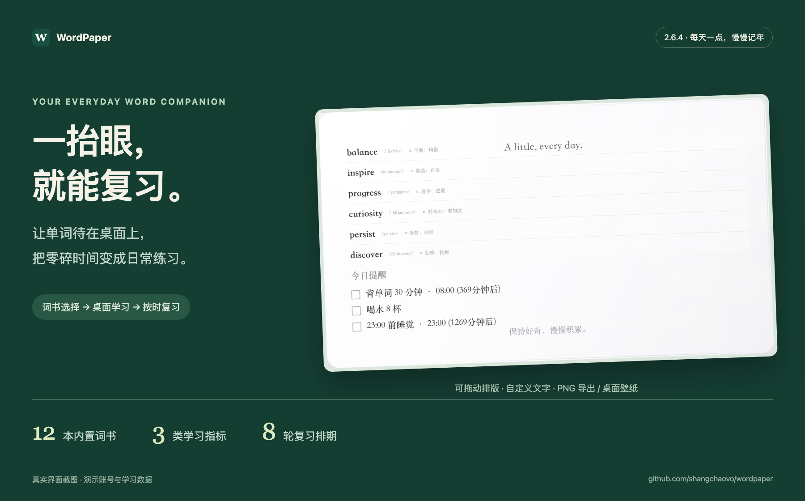
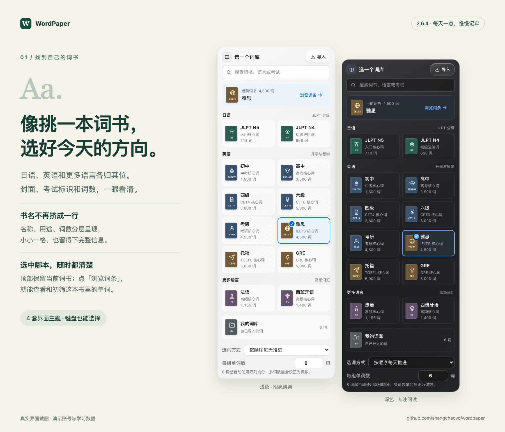
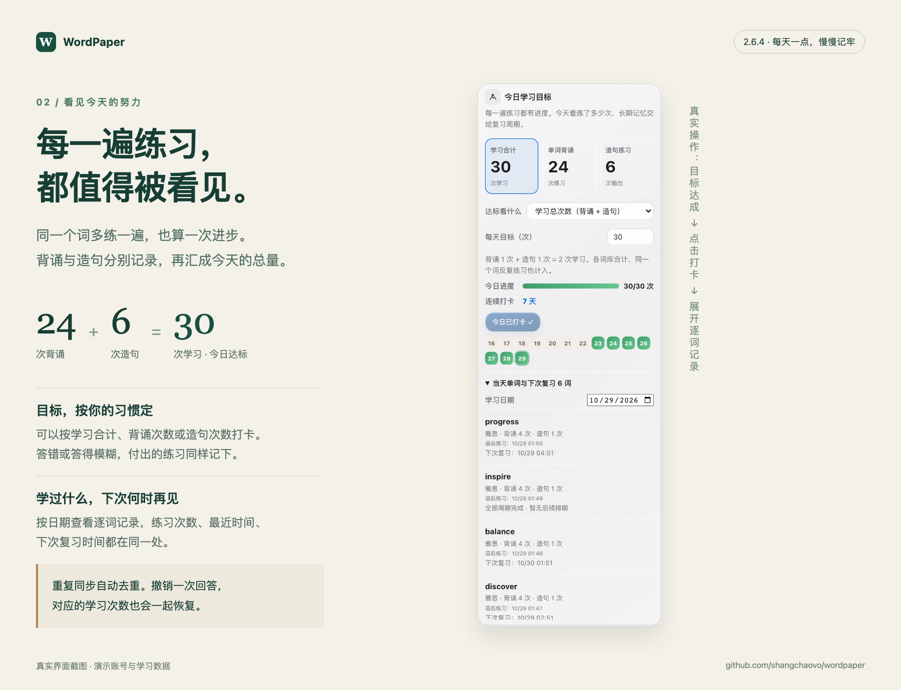
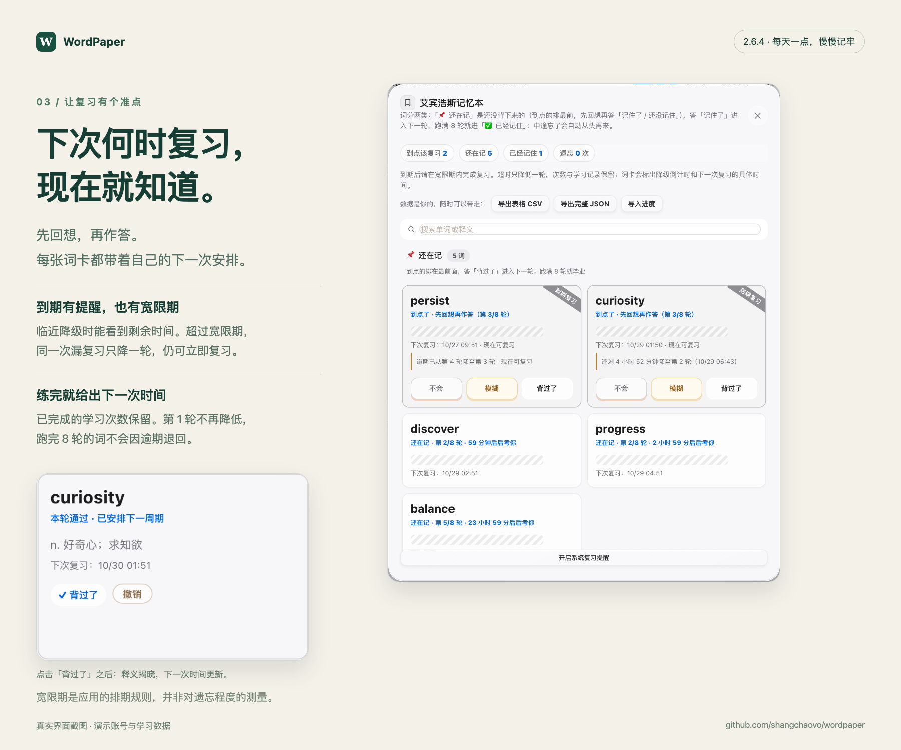

# WordPaper 2.6.4 · 每天一点，慢慢记牢

这次把词书目录、每日学习记录与复习排期一起更新：选书更清楚，练习有记录，下一次复习也有具体时间。

## 像挑一本词书，选好今天的方向

词库现在按日语、英语和更多语言分组。每本书都有对应的封面颜色、图标与考试标识，名称、用途、词数分行呈现。当前选择固定显示在顶部，点「浏览词条」即可查看和初筛。12 本内置词书之外，仍可用 CSV、Excel、粘贴或本机截图识别建立「我的词库」。浅色、深色、编辑风与动漫风四套界面都适配，键盘也能选择。

## 每一遍练习，都值得被看见

「今日学习目标」同时显示学习合计、单词背诵与造句次数。你可以按其中任一项设置每天的目标，完成后打卡。同一个词再练一遍会计入，答错、模糊或造句未满分也会记录这次练习。

展开「当天单词与下次复习」，可以按日期看到每个词练了几次、最近一次是什么时候、下一次复习在哪个时间。逐词明细保留最近 90 个自然日；原有打卡和旧版首轮计数继续保留。旧版未保存的复习与造句明细无法追溯，新记录从这次升级开始积累。

## 下次何时复习，现在就知道

每个词有自己的排期。先回想，再按「不会 / 模糊 / 背过了」作答，词卡会更新下一次复习的具体时间。答错手滑可以撤销，排期和本次计数一同恢复。

到期后还有按本轮实际间隔计算的宽限期，临近降级时会提示剩余时间。超过宽限期，同一次漏复习只降一轮，仍可立即复习；第 1 轮不再降低，完成全部 8 轮的词不降低，已完成的学习次数也保留。**已有积压词也从本版起适用；关闭复习提醒不会暂停逾期计时。** 这是应用的排期规则，并非对个人遗忘程度的测量。[查看详细规则与模型说明](../REVIEW-POLICY.md)。

## 主窗口关着，练习也能记下来

桌面小词灵、抽查与造句会在动作发生时保存记录，首次学习即时建立下次复习排期。重复轮询、重启或同步重放不会重复计数；撤销的练习不会被旧设备重新加回来。已连接同步账号的设备在离线时排队，恢复联网后合并学习活动。跨设备同步仍需要配置账号服务器，静态演示站只在当前浏览器保存数据。

## 下载与更新

| 你的 Mac | 安装包 |
| --- | --- |
| Apple 芯片（M 系列） | [Apple Silicon 完整版](https://github.com/shangchaovo/wordpaper/releases/download/companion-v2.6.4/WordPaper-macOS-AppleSilicon.dmg) |
| Intel 芯片 | [Intel 完整版](https://github.com/shangchaovo/wordpaper/releases/download/companion-v2.6.4/WordPaper-macOS-Intel.dmg) |
| 希望首次从国内镜像获取主运行环境 | [Slim 国内加速版](https://github.com/shangchaovo/wordpaper/releases/download/companion-v2.6.4/WordPaper-macOS-Slim.dmg) |

- **2.6.2 / 2.6.3 用户**：在 WordPaper 的「检查更新」中安装；安装完成后会自动重新打开 App。正式版本发布后，App 的例行检查也会发现新版。
- **2.6.1 及更早版本**：旧更新器无法替换原生程序，请下载完整 DMG，退出 App 后覆盖「应用程序」中的 WordPaper.app。之后可在 App 内更新。
- **第一次安装**：打开 DMG，将 WordPaper 拖入「应用程序」。当前 App 未经过 Apple Developer ID 签名；如果 macOS 拦截，前往「系统设置 → 隐私与安全性 → 仍要打开」。
- 账号、自定义词库、学习记录与设置保存在原用户数据目录，覆盖 App 不会清空它们。可在更新前用顶栏「备份」导出一份自己的数据。
- 三种包均包含语音环境；两个完整版另带主运行环境，Slim 首次打开需要下载。校验文件：[SHA256SUMS.txt](https://github.com/shangchaovo/wordpaper/releases/download/companion-v2.6.4/SHA256SUMS.txt)。

截图由 2.6.4 的真实页面操作生成，使用独立演示账号。图中的 30 次学习、7 天打卡和单词排期均为示例数据。
